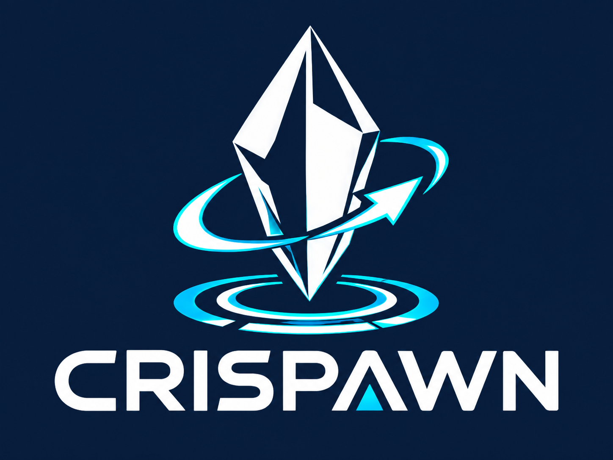

  

# CRISPAWN Community

CRISPAWN boots a small Linux environment to copy whole internal disks to a USB
hard disk and restore saved copies. The community edition works offline.
[日本語](README.ja.md)

Download the ISO and its SHA-256 file from
[Releases](https://github.com/bunbun-digital/crispawn/releases).
The original software is [Apache-2.0](LICENSE). The CRISPAWN name, logos and
branded artwork are [All rights reserved](examples/crispawn/assets/crispawn/LICENSE).
Third-party components keep their own licenses; the ISO is a mixed-license distribution.

## Demo

[Full video](https://github.com/bunbun-digital/crispawn/releases/download/v0.1.0-alpha.3/crispawn-demo-en.mp4)
· [日本語デモ](README.ja.md)

A six-second time-lapse of a real QEMU run, from the first application screen
after the splash to normal shutdown. The synthetic disk is 10 GB with 1 GB of
compressible demo data. This demo uses a five-second countdown; the default is 30 seconds.

## Use

A bootable USB has a FAT32 EFI System Partition and an NTFS data partition
labeled `CRISPAWN`. [CRISPAWN Builder](https://github.com/bunbun-digital/crispawn-builder)
can write the ISO and settings to a prepared drive. It is maintained in its own
repository. The ISO also contains BIOS and signed UEFI optical boot entries.
Optical boot requires a separate explicitly configured USB destination.

On boot, internal disks are discovered while the automatic-copy countdown runs.
The default is 30 seconds. Copy and restore use the same GUI/CUI controller.
Saved files, metadata and logs are under `crispawn/` on the NTFS partition.
The boot and destination disks are excluded from copy sources. Restore always
requires target selection and confirmation; it overwrites the selected disk.

Copies cover every sector, including encrypted data and partition metadata.
Files are compressed, kept below 2,000,000,000 bytes, and paired with BLAKE3
hashes of their original ranges. Saved data is checked concurrently.
A smaller destination is allowed when compression makes it fit; copying stops
if actual free space falls below 1,000,000,000 bytes.
Errors and shutdown behavior are configurable.

The community ISO contains no connection worker, Wi-Fi tools, network drivers,
or SMB/S3 storage backend. Settings cannot enable those features.
The signed Debian kernel retains its built-in IP stack and local sockets.
Network and remote-storage extensions are developed separately for CRISPAWN Pro.
The community code may be modified under Apache-2.0; the USB-only scope describes
official community builds, not a restriction on third-party modifications.

## Develop

See [BUILDING.md](BUILDING.md), [configuration](docs/CONFIGURATION.md),
[architecture](docs/ARCHITECTURE.md) and [licensing](docs/LICENSING.md).
Runtime code is split into the [copy and restore engine](examples/crispawn/rust/crates/engine),
[application UI](examples/crispawn/rust/crates/live-ui) and
[shared UI SDK](sdk/rust/crispawn-ui).
No old private repository, development ISO, SDK or Windows relay is required.

This is an early development release. See each release's test report for the
actual tested environment and limitations.

